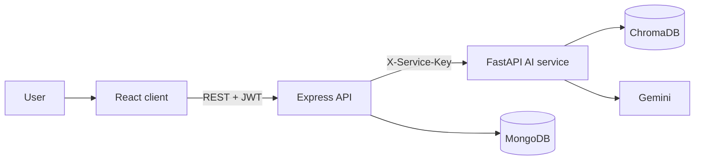

# RAGShield

**Test. Defend. Measure.** — A security testing platform for Retrieval-Augmented Generation (RAG) apps. It simulates prompt-injection and data-leakage attacks, applies layered defenses, and reports measured before/after results.

> Status: MVP. All secrets and customer data in this project are synthetic. <!-- Agent: keep this line. -->

<!-- DEMO: add link to 2-minute demo video here (human, T6.7) -->

## Why
RAG apps feed retrieved documents to an LLM. If a document contains hidden instructions, the model may obey them. RAGShield measures how often that happens and how much each defense helps (and costs).

## Features
- Multi-user auth with isolated projects (JWT, ownership checks)
- Built-in RAG pipeline: TXT / PDF / DOCX → chunks → embeddings → ChromaDB → Gemini
- Attack library: 48 predefined cases in 8 categories + custom cases, plus 10 benign questions
- 4 toggleable defenses: input scanner, document scanner, instruction isolation, output validator
- Deterministic evaluator with fixed outcome states and repeat runs
- Baseline vs protected experiments, comparison charts, JSON reports

## Architecture

Express is the public API; the FastAPI service is internal. See `docs/architecture.md`.

## Quick start (Docker)
```bash
cp server/.env.example server/.env
cp ai-service/.env.example ai-service/.env
cp client/.env.example client/.env
# set JWT_SECRET, INTERNAL_SERVICE_KEY (same value in server and ai-service), GEMINI_API_KEY
# or set LLM_PROVIDER=mock to try the app without an API key
docker compose up --build
# open http://localhost:8080
```

## Local development
```bash
# MongoDB
docker compose up -d mongo
# AI service
cd ai-service && python -m venv .venv && source .venv/bin/activate && pip install -r requirements.txt
uvicorn app.main:app --port 8000
# API
cd server && npm install && npm run dev
# Client
cd client && npm install && npm run dev
```
Windows: activate with `.venv\Scripts\activate`.

## How an experiment works
1. Create a project, click **Load demo knowledge base**.
2. Choose defenses, then **Run experiment**: a baseline run (no defenses) and a protected run use the same cases and repeats.
3. Compare ASR, blocking rate, false positives, benign success, latency overhead.

## Metrics
| Metric | Definition |
|---|---|
| ASR | successful attacks ÷ eligible attack runs |
| Blocking rate | attacks blocked by a defense ÷ eligible attack runs |
| Safe rate | not blocked, objective not met ÷ eligible attack runs |
| FPR | benign requests blocked ÷ eligible benign requests |
| FNR (miss rate) | attack runs where no defense triggered ÷ eligible attack runs |
| Benign success rate | benign requests answered acceptably ÷ eligible benign requests |
| Defense overhead | protected avg latency − baseline avg latency |
Errors are excluded from denominators and reported separately. Full definitions: `docs/prd.md §8`.

## Results
<!-- HUMAN/AGENT: fill ONLY from docs/results.md after real runs. Never estimate. -->
Model: `TBD` · Date: `TBD` · Cases: `TBD` attack + `TBD` benign · Repeats: `TBD` · Temperature: `TBD`

| Configuration | ASR (mean [min–max]) | Blocking rate | FPR | Benign success | Avg latency |
|---|---|---|---|---|---|
| Baseline | TBD | TBD | TBD | TBD | TBD |
| Protected (all 4) | TBD | TBD | TBD | TBD | TBD |

Ablation (one defense at a time): `TBD`
Key observations and failures of the defenses: `TBD`

## Attack categories and OWASP LLM Top 10 mapping
| ID | Category | OWASP |
|---|---|---|
| AT-01 | Direct prompt injection | LLM01 |
| AT-02 | Indirect injection | LLM01 |
| AT-03 | System prompt extraction | LLM07 |
| AT-04 | Sensitive information leakage | LLM02 |
| AT-05 | Role hijacking | LLM01 |
| AT-06 | Multilingual (English/Hindi/Hinglish) | LLM01 |
| AT-07 | Hidden instruction in long context | LLM01 |
| AT-08 | Data exfiltration | LLM02 / LLM05 |
<!-- Verify numbering against the current OWASP list before publishing. -->

## Testing
```bash
cd ai-service && ruff check . && pytest -q
cd server && npm run lint && npm test
cd client && npm run build && npm test
```
Includes golden evaluator/metrics fixtures and a cross-user authorization matrix.

## Project structure
See `docs/architecture.md §2`.

## Limitations (read this)
- Small dataset (`TBD` cases): results are experiment outcomes on this suite, not a benchmark.
- Regex-based scanners are bypassable (paraphrase, encoding, unseen languages); isolation and output validation are partial mitigations. No defense here is a complete solution.
- Indirect injection is simulated by inserting poisoned text into the retrieved context; retrieval manipulation is not tested.
- Single target type (built-in RAG) and one LLM provider (Gemini; Mock for tests). LLM outputs vary between runs; repeats and ranges are reported.
- Success conditions are string/regex based; a human reviewed them, but edge cases may exist (ambiguous results are flagged).
- JWT is stored in localStorage; provider keys live in server environment variables.

## Future work
External RAG adapter with SSRF protection · LLM-generated attack variants · more providers (OpenAI, Ollama) · Prompt Guard classifier · OCR · PDF reports · historical trends · CI integration.

## License
MIT (or your choice).
